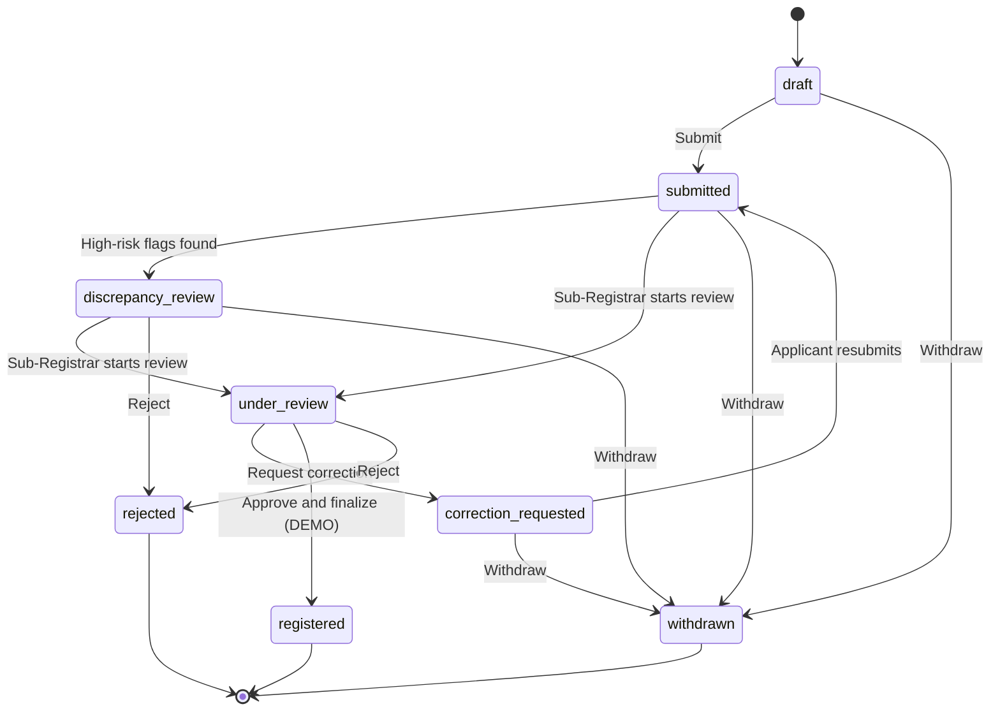
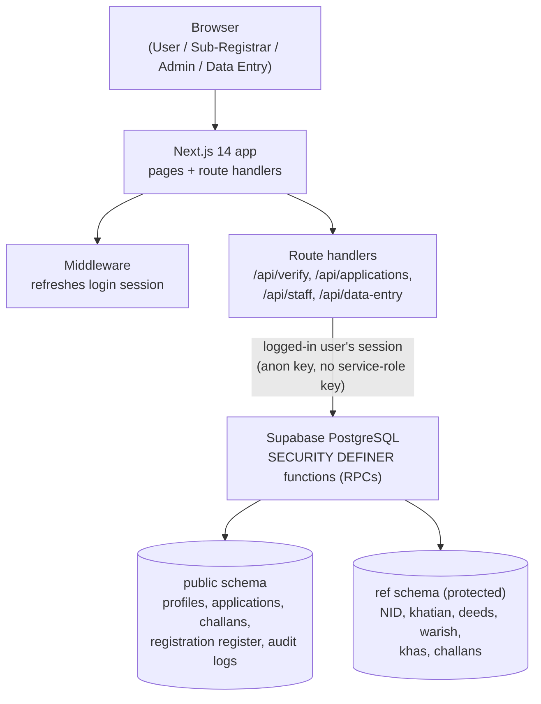

# Land Deed Integrity System (LDIS)

**ভূমি দলিল যাচাই ও নিবন্ধন · Land Deed Verification & Registration**

> A web-based land deed verification and registration system with built-in anti-corruption controls.
> Built by **Team Confused Team** for the **LandTech Innovation Hackathon 2026**.

| | |
|---|---|
| 🌐 **Live system** | <https://land-deed-integrity-system-ldis.vercel.app/> |
| 📄 **Full project report (PDF)** | [`LDIS_Project_Report.pdf`](./LDIS_Project_Report.pdf) |
| 📝 **Concept note (PDF, 3 pages)** | [`LDIS_Concept_Note.pdf`](./LDIS_Concept_Note.pdf) |
| 👥 **Team** | Confused Team (Team ID: LA-92) |
| ⚠️ **Status** | Demonstration prototype, **not** an official government system |

> **Important:** LDIS runs only on **fictional reference data**. It is not connected to the real NID database or the national land record system, it does not take real payments, and it does **not** create a legally valid registration. Every "registered" record is labelled **DEMO**.

---

## Table of Contents

1. [What is LDIS? (in simple words)](#1-what-is-ldis-in-simple-words)
2. [The problem we solve](#2-the-problem-we-solve)
3. [Our solution: the core idea](#3-our-solution-the-core-idea)
4. [Key features](#4-key-features)
5. [Who uses the system? (roles)](#5-who-uses-the-system-roles)
6. [How an application moves through the system](#6-how-an-application-moves-through-the-system)
7. [The anti-corruption rules in detail](#7-the-anti-corruption-rules-in-detail)
8. [Technology stack](#8-technology-stack)
9. [System architecture](#9-system-architecture)
10. [Database design](#10-database-design)
11. [Project folder structure](#11-project-folder-structure)
12. [Pages and API routes](#12-pages-and-api-routes)
13. [Getting started (run it locally)](#13-getting-started-run-it-locally)
14. [Database setup (Supabase migrations)](#14-database-setup-supabase-migrations)
15. [Deployment (GitHub → Vercel)](#15-deployment-github--vercel)
16. [Testing](#16-testing)
17. [Demo accounts](#17-demo-accounts)
18. [Limitations](#18-limitations)
19. [Future scope](#19-future-scope)
20. [Glossary: every term explained](#20-glossary-every-term-explained)
21. [Documentation index](#21-documentation-index)
22. [Team and mentors](#22-team-and-mentors)

---

## 1. What is LDIS? (in simple words)

In Bangladesh, land is the most valuable asset for most families, and land disputes are among the most common causes of court cases. Before a piece of land can be sold, someone must check many facts:

- Is the seller really the owner?
- Is the seller allowed to sell *this much* land?
- Has the same land already been sold to someone else?
- Is the land actually **government (khas) land**?
- Were all fees paid, and is the payment slip genuine?

Today these checks are mostly done **by hand, by one official**, using paper records. If that official is careless or dishonest, a wrong or illegal registration can go through.

**LDIS moves the most important checks from "a person's decision" to "rules that the system enforces".**
A citizen applies online through a guided 9-step form. The system automatically cross-checks identity, ownership, earlier sales, heirship and payments. The Sub-Registrar (the government official) then reviews the file inside the same system, with a fixed checklist. And for the most serious violation, such as selling government land, the **database itself refuses to register it, even if the official wants to approve it**.

> 💡 **Design goal:** *corruption should not be able to succeed even when an official is willing to cooperate.*

---

## 2. The problem we solve

These are the nine problems (P1–P9) from the project report that LDIS is designed to address.

| No. | Problem | What goes wrong in the manual process |
|---|---|---|
| P1 | Registration of government (khas) land | Government land can be registered privately if the official overlooks or ignores the government record. |
| P2 | Dependence on one official | The final decision rests on one Sub-Registrar; there is no automatic barrier against a wrong approval. |
| P3 | Identity and name mismatch | The owner's name in the khatian may differ from the NID record by spelling, order, or deliberate change. Manual comparison is subjective. |
| P4 | Double selling and overselling | The same plot, or more area than the owner's share, can be sold again because earlier sales are not systematically checked. |
| P5 | Heirship and share errors | Inherited land needs correct heir shares. Forged or wrong heirship certificates are hard to spot by eye. |
| P6 | Fake or reused payment challans | A forged challan, a wrong amount, or a challan already used for another deed can be shown as proof of payment. |
| P7 | Weak accountability | Paper decisions can be changed or lost; it is hard to prove later who approved what. |
| P8 | Lack of transparency for the applicant | Applicants often do not know which documents are needed, what fees are due, or why they are delayed. |
| P9 | Jurisdiction misuse | An official might process applications that do not belong to his or her office. |

---

## 3. Our solution: the core idea

| Principle | Meaning |
|---|---|
| **Rules over discretion** | Integrity checks are coded as rules. A person can add judgement, but cannot remove a rule. |
| **Enforcement in the database** | The most critical rules run inside PostgreSQL functions and triggers. Bypassing the website does not bypass the rule. |
| **Evidence before approval** | Approval is impossible until all required evidence (checklist, challans, biometric status, attestation/affidavit where needed) is recorded. |
| **Explainable warnings** | Every risk indicator says what was found, the data source, and that it is a *warning*, not a legal verdict. |
| **Least privilege** | The browser never reads the reference data directly. Each role sees only what it needs. |
| **Permanent accountability** | Every sensitive action is written to an append-only audit log. |

### How each problem is solved

| No. | Problem | LDIS solution |
|---|---|---|
| P1 | Khas land registration | Location, khatian and dag are matched against the government-interest (khas) table. On a match, the database refuses every decision except **Reject**, for Sub-Registrar and Admin alike. |
| P2 | Dependence on one official | Approval needs the 12-point checklist, no blockers, completed biometric status and verified challans. These rules cannot be overridden from the interface. |
| P3 | Name mismatch | Bangla-aware name normalization and similarity scoring with a provisional **90 %** threshold. 50 %–90 % needs a verified attestation; below 50 % needs the original affidavit. |
| P4 | Double selling | Dag history shows all earlier deeds. The system computes entitled and remaining land and raises High-risk warnings when a sale exceeds the dag area or the donor's entitlement. |
| P5 | Heirship errors | Warish certificates are looked up and heir shares are used in the remaining-land calculation; wrong share totals are flagged. |
| P6 | Fake or reused challans | Each challan is matched on number, amount and fee type against reference records; a challan already used by another application is rejected. |
| P7 | Weak accountability | Append-only audit logs and status history record actor, role, action, note and time of every decision. |
| P8 | Lack of transparency | Guided wizard, Bangla + English status explanations, correction messages, notifications and a visible appointment. |
| P9 | Jurisdiction misuse | A Sub-Registrar can see and decide only applications whose office district and upazila match the officer's own profile. |

---

## 4. Key features

**For citizens (Users)**
- Sign up, log in, and wait for administrator approval.
- Verification tools: check land, person (NID), deed, warish certificate and challan against the reference records.
- A **9-step application wizard** with auto-saved drafts.
- Automatic fee calculation (stamp fee, registration fee, source tax).
- Challan entry and verification, automatic challan numbering.
- Private document upload, biometric appointment booking.
- Status tracking with Bangla + English explanations, correction requests and notifications.

**For Sub-Registrars**
- A jurisdiction-filtered list of deed applications (only their own upazila).
- A **12-point review checklist**.
- Request correction, reject, or approve and finalize.
- Record biometric result, verify attestation, record receipt of the original affidavit.
- Printable registered deed (DEMO).

**For Administrators**
- Approve new user accounts.
- Dashboard statistics, the queue of all applications, the list of Sub-Registrars with their jurisdictions, and recent audit log entries.
- Same verification tools as other staff.

**For Data Entry Operators**
- A controlled, validated form to enter reference data without direct database access.

**Cross-cutting**
- Bangla + English interface, Bangla/English digit normalization (numbers typed in either script match).
- Risk indicators: **High / Medium / Info / Unknown**.
- Honest "unknown" handling: *"No record found" is never shown as "clear".*
- Row Level Security, append-only audit trail, atomic finalization.

---

## 5. Who uses the system? (roles)

| Role | Home page | What they can do |
|---|---|---|
| **User** (ব্যবহারকারী) | `/dashboard` | Verify records, create and submit applications, upload documents, book appointments, track status, respond to correction requests. |
| **Sub-Registrar** (সাব-রেজিস্ট্রার) | `/sub-registrar` | Review applications of their own district and upazila, complete the 12-point checklist, request corrections, reject, approve, record biometric status, verify attestation/affidavit, finalize registration. |
| **Administrator** (প্রশাসক) | `/admin` | Approve user accounts, view statistics, all applications, registrar list and audit log. |
| **Data Entry Operator** (ডাটা এন্ট্রি অপারেটর) | `/data-entry` | Enter reference data manually through a controlled form. |

> 🔐 The role is stored in the `profiles` table of the database. It is **never** taken from a form field or user metadata. Public signup can create **only** ordinary Users. Sub-Registrar and Administrator roles are provisioned by an authorised database administrator.

---

## 6. How an application moves through the system

### End-to-end journey

1. **Sign up and log in.** New accounts are always ordinary users and need administrator approval.
2. **Verify.** The user may use the verification tools to check land, person, deed, heirship and challan information.
3. **Apply.** The user completes the nine-step wizard.
4. **Automated checks.** The system recomputes derived values on the server and attaches blockers and risk flags.
5. **Review.** The Sub-Registrar of the matching upazila reviews the application with the 12-point checklist.
6. **Decision.** The officer requests correction, rejects, or approves. Government-interest cases can **only** be rejected.
7. **Biometric and evidence.** Appointment and biometric status, plus attestation or affidavit where required, are recorded.
8. **Finalization.** An atomic database transaction creates the registration record with a unique reference and an audit entry.

### The nine-step application wizard

| Step | Name | Content |
|---|---|---|
| 1 | Donor and donee (দাতা ও গ্রহীতা) | Identity of the donor and one or more donees by NID; comparison against NID records. |
| 2 | Land and khatian (জমির তফসিল) | Select location, khatian type and khatian; determines the registration office by district and upazila. |
| 3 | Ownership basis (মালিকানার ভিত্তি) | Recorded owner or through heirship (warish); name-match result and attestation requirement. |
| 4 | Dags and area (দাগ ও পরিমাণ) | Select dags and sale area, with the remaining-land check. |
| 5 | Class and price (শ্রেণি ও মূল্য) | Land class (নাল, বাড়ি, ভিটা, মাটিয়াল, পুকুর) and sale price. |
| 6 | Fees and challans (ফি ও চালান) | Automatic stamp fee, registration fee and source tax; challan entry and verification. |
| 7 | Documents (সহায়ক নথি) | Upload NID copy, porcha copy, warish certificate, previous deed, attestation, other documents to private storage. |
| 8 | Appointment (বায়োমেট্রিক তারিখ) | Book a biometric appointment from available slots; holidays and capacity are respected. |
| 9 | Review and submit (পর্যালোচনা ও জমা) | Summary of all data and blockers; final submission. |

Each step shows **blockers** returned by the database, so the user knows exactly what to fix before submitting. A *deed-nature gate* asks for the nature of the deed first.

### Application statuses



| Status (code) | Bangla / English label | Meaning |
|---|---|---|
| `draft` | খসড়া · Draft | Not submitted yet. Can be saved and continued. |
| `submitted` | জমা হয়েছে · Submitted | Waiting for Sub-Registrar review. Normal editing is closed. |
| `discrepancy_review` | অসংগতি যাচাইয়ে আটকানো · Held for discrepancy review | One or more high-risk indicators found. **This is not proof of fraud**; an official will review. |
| `under_review` | পর্যালোচনাধীন · Under review | A Sub-Registrar is reviewing the application. |
| `correction_requested` | সংশোধন প্রয়োজন · Correction requested | The office asked for corrections. Fix the data and resubmit. |
| `registered` | নিবন্ধিত · Registered | Deed registered (**DEMO** only). |
| `rejected` | প্রত্যাখ্যাত · Rejected | Application rejected. |
| `withdrawn` | প্রত্যাহার করা হয়েছে · Withdrawn | The applicant withdrew the application. |

---

## 7. The anti-corruption rules in detail

### 7.1 Government land hard stop
The database checks whether any selected plot matches a record in the **khas** (government land) table by location, khatian number and dag number, or whether the application carries a computed `GOVT_INTEREST_MATCH` flag. If so:

- the decision function accepts **only Reject**; Approve and every other decision is refused with the message *"Government-interest record found: registration is prohibited. Only Reject is allowed."*;
- the rejection must include a reason of at least five characters;
- the final registration function applies the same check again before creating a registration record;
- the rule applies to **both** the Sub-Registrar and the Administrator.

> **Scenario:** Someone offers an inducement to a Sub-Registrar to register a plot recorded as khas land. Even if the officer completes the checklist and presses *Approve*, the database returns an error. The only possible action is *Reject*, which is permanently logged with the officer's identity and reason. The incentive for corruption disappears because the outcome cannot be changed by the official.

### 7.2 Conditions that must hold before approval

| Condition | Enforcement |
|---|---|
| Status is *Under review* | Approval from any other status is refused. |
| No unresolved blockers | Blockers are recomputed on the server; approval fails if any remain. |
| Biometric status is *completed* | Approval and finalization are refused until the outcome is recorded. |
| All 12 checklist items are *Correct* | Checked in the decision function **and** again by a trigger on the registration register. |
| Attestation verified (name match 50 %–90 %) | Needs an uploaded attestation document and verification by the Sub-Registrar. |
| Affidavit received (name match below 50 %) | The Sub-Registrar must record receipt of the original affidavit after biometric completion. |
| Challans verified | Each challan must match the reference record on number, amount, type and verified status, and must not be used elsewhere. |

### 7.3 The 12-point Sub-Registrar checklist

| No. | Checklist item |
|---|---|
| 1 | Application number, applicant details and deed nature are correct. |
| 2 | Donor and donee names and identity details are correct. |
| 3 | Donor and donee NID and date of birth are correct. |
| 4 | Khatian and basis of ownership are verified. |
| 5 | The chain of baya (previous) deeds is consistent. |
| 6 | Dag numbers, land area and remaining land are correct. |
| 7 | Land class and location are correct. |
| 8 | Government-interest and restriction information has been reviewed. |
| 9 | Required supporting documents have been reviewed. |
| 10 | Fee calculation is correct. |
| 11 | Challan number, amount and payment verification are correct. |
| 12 | Appointment, biometric and registration-related information is correct. |

Every item must be saved as **Correct** or **Incorrect**. An *Incorrect* item needs a written reason.

### 7.4 Name matching

The owner's name in the porcha (khatian) is compared with the NID name. Text is normalized (Unicode normalization, removal of zero-width joiners and extra spaces, Bangla-digit conversion) and a similarity score is computed using **Levenshtein distance**. The name and the father/spouse name are scored separately.

| Score | Outcome |
|---|---|
| **90 % or higher** | Provisional match. It does *not* prove legal ownership; it only means no discrepancy review is triggered. |
| **50 % to below 90 %** | Discrepancy. The applicant must upload an **attestation**, and the Sub-Registrar must verify it before approval. |
| **Below 50 %** | Serious discrepancy. The Sub-Registrar must record receipt of the **original affidavit** on the biometric day before approval. |
| **Missing data** | Marked "insufficient data" and sent for review; never treated as a match. |

> The 90 % threshold is **provisional** and must be confirmed by the competent authority before any real use.

### 7.5 Remaining land calculation

For every dag, the system computes how much land the donor is entitled to and how much is still available:

```
entitled area = dag area × owner's recorded share        (× heir's share if ownership comes through warish)
remaining     = entitled area − earlier sales by the donor on the same dag
```

If the proposed sale is larger than the remaining area, a **High** risk indicator is raised and the application is blocked. Assumptions (for example, that the same share applies on every dag, and that partitions and cancelled deeds are not modelled) are shown with the result. All areas are in **shotok** (1 shotok = 1/100 acre).

### 7.6 Risk indicator levels

Indicators are for display and decision support only. They **never** approve or clear anything automatically.

| Level | Meaning | Examples |
|---|---|---|
| **High** | Hold the case for review | NID/porcha mismatch below 90 %; dag oversold; donor already sold more than entitlement; proposed sale exceeds remaining land; government-interest record found; several deeds with the same number and date. |
| **Medium** | Needs attention | Owner shares do not total 1; other donors have deeds on the same dag. |
| **Info** | Context only | Provisional identity match; donor has earlier sales; same deed number on other dates; attestation exists. |
| **Unknown** | Data gap, **not** clearance | No government record found in the supplied database; deed or warish not found; identity data missing. |

### 7.7 Other protections

| Control | What it does |
|---|---|
| **Jurisdiction lock** | Staff functions select applications by matching the officer's district + upazila to the application's office district + upazila. A partial unique index allows only one Sub-Registrar per upazila. |
| **Role integrity and RLS** | Roles come from `profiles`. RLS is enabled on reference and sensitive tables, and no browser role has direct access to them. |
| **Atomic finalization** | One transaction: lock the application row, validate everything, create a unique registration reference, insert the register row, change status, write history + audit log, notify. If any step fails, **everything** is rolled back. A unique constraint prevents a second registration for the same application. |
| **Append-only audit trail** | Triggers on the audit log and registration register reject any `UPDATE` or `DELETE` ("records are append-only"). |
| **Safe redirects** | Prevents redirection to untrusted addresses after login. |
| **Server-side validation** | All input is validated on the server; client-supplied derived values (fees, areas) are rejected and recomputed. |
| **Security headers** | `X-Content-Type-Options`, `X-Frame-Options: DENY`, `Referrer-Policy`, `Permissions-Policy` are set in `next.config.js`. |
| **No secrets in the repo** | The browser uses only the public Supabase URL and anon key. No service-role key is used. |

### 7.8 Honest limits of the design

1. The government-interest rule depends on the **completeness of the khas data**. "No record found" is shown as *"This is NOT clearance"*.
2. A person with privileged access to the **database itself** (the database owner) is outside the application's controls. This needs strict access management and monitoring.
3. The name-match threshold and some ownership rules are provisional and need legal confirmation.
4. The audit log protects against editing through normal operations but should be complemented by external backups and monitoring in production.

---

## 8. Technology stack

| Layer | Technology | Why |
|---|---|---|
| Frontend + server | **Next.js 14** (App Router), **React 18**, JavaScript | Server-side rendering, route handlers, one code base. |
| Styling | **Tailwind CSS** | Fast, consistent, responsive design. |
| Database | **PostgreSQL** (via **Supabase**) | Relational DB with RLS, triggers, functions, transactions. |
| Authentication | **Supabase Auth** with `@supabase/ssr` | Secure session handling for server and browser. |
| Hosting | **Vercel** (region `sin1`, Singapore) | Simple deployment from GitHub with HTTPS. |
| Version control | **GitHub** | Source history and collaboration. |
| Testing | Node.js built-in test runner, SQL check scripts | Unit tests for logic; manual SQL checks for security rules. |

Requirements: **Node.js ≥ 18.18**, npm.

---

## 9. System architecture



The browser talks only to the Next.js app. Middleware refreshes the session. Route handlers call database functions using the logged-in user's session. **The database functions repeat the role and jurisdiction checks**, and the `ref` schema is reachable only through limited verification functions.

**Example: what happens when a Sub-Registrar presses "Approve"**

1. The browser sends the request to the staff route handler.
2. The handler checks that the user is logged in and has an approved staff role.
3. The handler calls the database function `staff_decide_application`.
4. The function locks the application row, confirms jurisdiction, checks the government-interest rule, checklist, blockers, biometric status, name-match evidence and challans.
5. If everything passes, it records the decision, a status-history row, an audit entry and a user notification. If anything fails, it raises an error and **nothing is saved**.

---

## 10. Database design

The database has **two schemas**:

| Schema | Holds | Access |
|---|---|---|
| `ref` | Imported **reference data** that represents the official records LDIS verifies against: locations, NID persons, khatians with owners and dags, deeds, warish certificates and heirs, name attestations, government-interest (khas) records, reference challans. | **Protected.** RLS enabled, no public policies, no grants to browser roles. Reachable only through limited `SECURITY DEFINER` verification functions. |
| `public` | Data **created by the system**: profiles (role, approval, jurisdiction), deed applications, parties, ownership, plots, fee items, challans, documents, appointments, status history, corrections, identity evidence, registrar review checklist, registration register, audit logs, notifications. | RLS enabled; access through role-checked RPCs. |

**Key database functions (RPCs)**

| Function family | Purpose |
|---|---|
| `verify_…` | Controlled lookups into the `ref` schema (land, person, deed, warish, challan, khas). |
| `app_…` | Create, update, submit, withdraw and recompute applications, with ownership and state checks. |
| `staff_queue`, `staff_application_detail` | Jurisdiction-filtered views for officers. |
| `staff_decide_application` | All staff decisions, with government-interest, checklist and evidence rules. |
| `staff_save_review_checklist` | Saves the 12 checklist decisions and writes an audit entry. |
| `staff_finalize_registration` | Atomic registration with row lock and preconditions. |
| `admin_summary` | Administrator-only statistics and recent audit data. |

See [`docs/DATABASE_MAP.md`](./docs/DATABASE_MAP.md) and [`docs/DATABASE_MIGRATIONS.md`](./docs/DATABASE_MIGRATIONS.md) for details.

---

## 11. Project folder structure

```
.
├── app/                      # Next.js App Router: pages and API route handlers
│   ├── page.js               # Home page
│   ├── login/ , signup/      # Authentication pages and server actions
│   ├── pending-approval/     # Shown until an admin approves the account
│   ├── access-denied/        # Shown when a role opens another role's page
│   ├── dashboard/            # User dashboard, application list, wizard edit, detail
│   ├── verify/               # Verification tools (land, person, deed, warish, challan)
│   ├── sub-registrar/        # Sub-Registrar panel and application review
│   ├── admin/                # Administrator panel and application detail
│   ├── data-entry/           # Data Entry Operator page
│   ├── registered-deeds/     # Printable registered deed (DEMO)
│   ├── auth/signout/         # Logout route
│   └── api/                  # Server routes: verify/*, applications/[action],
│                             #   staff/[action], data-entry/*
├── components/               # React components
│   ├── applications/         # Wizard + all 9 step components, fee table, appointment panel
│   ├── verify/               # Lookup forms, location picker, risk indicators
│   ├── staff/                # Registrar checklist and decision actions
│   ├── admin/                # User approval panel, admin workspace
│   ├── data-entry/           # Manual data entry form
│   └── registered-deeds/     # Print button
├── lib/                      # Shared logic (no UI)
│   ├── supabase/             # Browser, server and middleware Supabase clients
│   ├── verify/               # matching.js (name similarity), risk.js (indicators),
│   │                         #   remaining.js (remaining land), schemas.js (validation)
│   ├── applications/         # status.js, steps.js, schemas.js, format.js
│   ├── roles.js , auth.js    # Roles, role home pages, login helpers
│   ├── safe-redirect.js      # Safe redirect after login
│   └── env.js                # Reads the public Supabase settings
├── supabase/
│   ├── migrations/           # SQL migrations 06 → 26 (see section 14)
│   ├── tests/                # Manual SQL checks (stage 2 and stage 3)
│   └── verify_*.sql          # SQL scripts that verify RPC / RLS security
├── tests/                    # Node.js unit tests
├── docs/                     # Project documentation (specs, handoffs, test report)
├── public/photo/             # Logo and hero image
├── middleware.js             # Session refresh on every request
├── next.config.js            # Security headers
├── vercel.json               # Vercel region (sin1)
├── tailwind.config.js , postcss.config.js
├── package.json
├── LDIS_Project_Report.pdf   # The full project report
└── LDIS_Concept_Note.pdf     # The 3-page concept note
```

---

## 12. Pages and API routes

### Pages

| Route | Who | Purpose |
|---|---|---|
| `/` | Everyone | Home page |
| `/login`, `/signup` | Everyone | Authentication |
| `/pending-approval` | New users | Waiting for admin approval |
| `/access-denied` | Any | Wrong-role message |
| `/dashboard` | User | User home |
| `/dashboard/applications` | User | List of own applications and new-application wizard |
| `/dashboard/applications/[id]` | User | Application detail and status |
| `/dashboard/applications/[id]/edit` | User | Continue a draft / fix a correction |
| `/verify`, `/verify/land`, `/verify/person`, `/verify/deed`, `/verify/warish`, `/verify/challan` | Logged-in roles | Verification tools |
| `/sub-registrar`, `/sub-registrar/applications/[id]` | Sub-Registrar | Deed list and application review |
| `/admin`, `/admin/applications/[id]` | Administrator | Admin dashboard and application detail |
| `/data-entry` | Data Entry Operator | Manual reference data entry |
| `/registered-deeds/[id]/print` | Staff | Printable DEMO deed |

### API route handlers

| Route | Purpose |
|---|---|
| `/api/verify/locations`, `khatian-types`, `khatian`, `khatian-by-dag`, `dag-history`, `owner-check`, `khas`, `nid`, `deed`, `warish`, `challan` | Verification lookups (all go through controlled database functions) |
| `/api/applications/[action]` | Application actions: create, update, submit, withdraw, etc. |
| `/api/staff/[action]` | Staff actions: queue, detail, decide, checklist, finalize, admin summary |
| `/api/data-entry`, `/api/data-entry/options` | Data entry submit and dropdown options |

---

## 13. Getting started (run it locally)

### Prerequisites
- **Node.js 18.18 or newer** (Node 20 LTS recommended) and npm
- A **Supabase** project (free tier is enough) with the migrations applied (see [section 14](#14-database-setup-supabase-migrations))

### Steps

```bash
# 1. Clone the repository
git clone https://github.com/<your-username>/<your-repository>.git
cd <your-repository>

# 2. Install dependencies
npm install

# 3. Create your environment file
cp .env.example .env.local        # if .env.example does not exist, create .env.local by hand
```

Put these two values in `.env.local` (from Supabase → *Project Settings → API*):

```env
NEXT_PUBLIC_SUPABASE_URL=https://YOUR_PROJECT_REF.supabase.co
NEXT_PUBLIC_SUPABASE_ANON_KEY=YOUR_SUPABASE_ANON_PUBLIC_KEY
```

```bash
# 4. Start the development server
npm run dev
# open http://localhost:3000
```

### Available scripts

| Command | What it does |
|---|---|
| `npm run dev` | Start the development server |
| `npm run build` | Create a production build |
| `npm start` | Run the production build |
| `npm run lint` | Run ESLint |
| `npm test` | Run the unit tests (Node.js test runner) |

> 🔒 **Never** put a Supabase **service-role key**, database password or JWT secret in `.env.local`, in `NEXT_PUBLIC_*` variables, or in the repository. Only the public URL and anon key are used. Make sure `.env.local` is listed in `.gitignore`.

---

## 14. Database setup (Supabase migrations)

The SQL files in [`supabase/migrations/`](./supabase/migrations) must be applied **in numeric order**, and **only if missing**. They assume the `ref` schema and its reference data already exist.

| Migration | Purpose (summary) |
|---|---|
| `06_verification_rpcs.sql` | Verification functions against the `ref.*` tables |
| `07_application_tables.sql` | Application tables, fee/status/appointment configuration, triggers, RLS |
| `08_application_logic.sql` | Application workflow logic |
| `09_application_rpcs.sql` | User-facing application RPCs |
| `10_stage3_registrar_admin.sql` | Registration register, audit logs, staff and admin RPCs |
| `11_user_approval_and_admin_roles.sql` | Account approval and admin roles |
| `12_super_admin_and_lookup_rules.sql` | Super-admin and lookup rules |
| `13_multi_donee_and_jurisdiction.sql` | Multiple donees and jurisdiction handling |
| `14_super_admin_dummy_data_import.sql` | Dummy data import |
| `15_manual_data_entry_operator.sql` | Data Entry Operator role |
| `16_fix_challan_verify_status.sql` | Challan verification status fix |
| `17_challan_and_registrar_checklist.sql` | Challan handling and the registrar checklist |
| `18_registered_deeds_archive.sql` | Registered deeds archive |
| `19_deed_nature_witness_and_numbering.sql` | Deed nature, witness and numbering rules |
| `20_auto_challan_numbering.sql` | Automatic challan numbering |
| `21_existing_deed_details_and_print.sql` | Existing deed details and print support |
| `22_challan_format_2627.sql` | Challan number format |
| `23_registrar_identity_and_govt_interest_rules.sql` | Registrar identity and government-interest rules |
| `24_attestation_number_and_affidavit_declaration.sql` | Attestation number and affidavit declaration |
| `25_attestation_father_match_support.sql` | Father-name match support for attestation |
| `25_data_entry_fixes_and_porcha.sql` | Data entry fixes and porcha handling |
| `26_fix_khatian_dag_normalization.sql` | Khatian/dag normalization fix |

**Safe procedure**

1. Take and verify a backup. Test on a **staging** project first.
2. Check which migrations are already applied. Do **not** blindly re-run every file.
3. Apply only the missing migrations, in order.
4. Never reset, truncate, drop or reseed the `ref.*` tables.
5. Run `supabase/verify_rpc_security.sql`, `supabase/verify_stage2_security.sql` and the manual checks in `supabase/tests/`.
6. Provision `sub_registrar` and `admin` roles through a controlled privileged database process. Signup must never assign them.
7. Confirm each Sub-Registrar's district/upazila, and that application office district/upazila values are correct (otherwise an application can become invisible to its registrar).

Full details: [`docs/DATABASE_MIGRATIONS.md`](./docs/DATABASE_MIGRATIONS.md).

---

## 15. Deployment (GitHub → Vercel)

1. Push the project to a GitHub repository (do **not** commit `.env.local`, `node_modules`, `.next` or `.vercel`).
2. In **Vercel**, import the repository. Vercel detects Next.js automatically.
3. Add the environment variables `NEXT_PUBLIC_SUPABASE_URL` and `NEXT_PUBLIC_SUPABASE_ANON_KEY` (separately for Preview and Production).
4. In **Supabase → Authentication → URL Configuration**, set the Site URL and the exact redirect URLs for local, preview and production addresses.
5. Deploy and test: signup/login/logout, protected routes, user ownership, registrar jurisdiction, admin-only summary.

Full guide: [`docs/DEPLOYMENT_GUIDE.md`](./docs/DEPLOYMENT_GUIDE.md).

---

## 16. Testing

```bash
npm test
```

Unit tests use the built-in Node.js test runner (`tests/*.test.mjs`); 12 tests passed with 0 failures at the time of the final test report. They cover:

- application input validation and rejection of client-supplied derived values;
- application status and wizard navigation logic;
- Bangla and English digit normalization and name similarity;
- identity-match outcomes and remaining-land arithmetic;
- behaviour of "unknown" government-interest results, challan indicators, and deed/history indicators.

**SQL security checks** are in `supabase/verify_rpc_security.sql`, `supabase/verify_stage2_security.sql` and `supabase/tests/`. A full role-matrix test on a staging database (two users, two Sub-Registrars of different jurisdictions, one Administrator, including forged-role and unauthenticated calls) is recommended before any real use. See [`docs/FINAL_TEST_REPORT.md`](./docs/FINAL_TEST_REPORT.md).

---

## 17. Demo accounts

The live system shows two demo accounts on its login page, so you can explore the interface:

| Role | Email | Password |
|---|---|---|
| Demo User | `landtech@ldis.com` | `12345678` |
| Demo Sub-Registrar (Manikganj Sadar) | `sub_register.manikganj_sadar@ldis.com` | `Abc@12345` |

> These accounts exist only on the demo deployment, and all data behind them is fictional. For your own Supabase project, the matching accounts must be created and approved in Supabase first.

---

## 18. Limitations

LDIS is a **prototype** and must be described honestly:

- It uses **fictional reference data** and is **not** an official government system. It does not produce a legally valid registration.
- No integration with the official **NID database** or the national **land record system**.
- No real **payment gateway**; challans are verified against demo reference records.
- No physical **biometric capture**; the officer records the biometric result.
- Fees, minimum amounts, taxes and appointment calendars are **demonstration values** (stored in `public.fee_config`) that must be confirmed with the authority.
- The 90 % name-match threshold, the share-calculation assumptions and the handling of partitions and cancelled deeds are **provisional**.
- A missing government-interest record is **not** proof that the land is free of government interest.
- Complete role-based security tests against a staging database are still recommended.

---

## 19. Future scope

| Future feature | Benefit |
|---|---|
| Integration with the national NID service and official land record system | Real identity and ownership data in place of reference data |
| Online payment gateway (bank, mobile financial services) | Direct, instantly verified fee payment |
| Real biometric / fingerprint device integration | Genuine identity capture at the office |
| OCR and AI-based document reading | Automatic data extraction from NID, porcha and deeds; detection of tampered documents |
| Blockchain or hash-anchored deed records | Extra tamper evidence for the registration register |
| QR code on deeds for public verification | Anyone can confirm a deed is genuine |
| SMS and email notifications | Immediate alerts to applicants and officers |
| Full language toggle (Bangla / English) | Better accessibility |
| Full modelling of inheritance, partition and joint ownership | More accurate entitlement and remaining-land calculation |
| Anomaly detection and analytics dashboards | Spot suspicious patterns, e.g. an officer with unusual approval rates |
| Rate limiting, monitoring and alerting | Protection against abuse, faster incident response |
| Mobile application | Easier access in rural areas |
| Two-person approval for high-value or flagged cases | Further separation of duties |

---

## 20. Glossary: every term explained

### 20.1 Land administration terms (Bangladesh)

| Term | Meaning |
|---|---|
| **Khatian / Porcha** (খতিয়ান / পর্চা) | The record-of-rights document that lists the recorded owners of a piece of land with their shares. In this project "khatian" and "porcha" mean the same record. |
| **Dag** (দাগ) | The plot number inside a khatian. One khatian can contain several dags, each with its own area and land class. |
| **Shotok** (শতক) | Unit of land area equal to one hundredth of an acre. All areas in LDIS are in shotok. |
| **Deed / Dolil** (দলিল) | The legal document that records a transfer of land, e.g. a sale or a gift. |
| **Saf kabala** (সাফ-কবলা) | A sale deed (a type of deed nature used in the demo data). |
| **Baya deed** (বায়া দলিল) | The previous (parent) deed through which the current owner got the land. The chain of baya deeds shows how land passed from owner to owner. |
| **Donor / Donee** (দাতা / গ্রহীতা) | The donor transfers the land (seller). The donee receives it (buyer). |
| **Warish certificate** (ওয়ারিশ সনদ) | A certificate of heirship listing the legal heirs of a deceased person and each heir's share. |
| **Khas land** (খাস জমি) | Land owned by the government. Private registration of such land is prohibited. |
| **Government interest** | A record showing that a plot is government (khas) land or otherwise restricted. |
| **Challan** (চালান) | A payment slip that proves a fee (stamp duty, registration fee, source tax) was paid to the government. |
| **Stamp fee / Registration fee / Source tax** | The three main fees calculated in the fee breakdown (in the demo: 1.5 %, 1 % and 1 % of the sale price respectively; demo rates only). |
| **Attestation** (প্রত্যয়নপত্র) | A formal statement that two differently written names (e.g. a spelling variation) refer to the same person. |
| **Affidavit** (হলফনামা) | A sworn written statement. In LDIS it is the strongest identity evidence, used when names differ widely. |
| **Sub-Registrar** (সাব-রেজিস্ট্রার) | The government official who reviews and registers deeds in a sub-district (upazila) office. |
| **Upazila / District** (উপজেলা / জেলা) | Administrative units of Bangladesh. A Sub-Registrar office is identified by its district and upazila. |
| **Mouza** (মৌজা) | The smallest land-revenue area (village-level unit) used to locate a khatian. |
| **NID** | National Identity Card, the national identification record of a citizen. |
| **Biometric** | Fingerprint or similar identity capture performed at the registration office on the appointment date. |
| **Land class** (জমির শ্রেণি) | The category of land recorded for a dag. Options in the wizard: নাল, বাড়ি, ভিটা, মাটিয়াল, পুকুর. |
| **BRS** | A khatian type (record series) shown in the demo data, e.g. "BRS khatian 2500". |

### 20.2 Technical terms

| Term | Meaning |
|---|---|
| **Web application** | A program that runs in a browser and needs no installation. |
| **Next.js / React** | JavaScript technologies used to build the pages and server logic. |
| **App Router** | Next.js routing system where the folders inside `app/` define the URLs. |
| **Tailwind CSS** | A styling framework used to design the interface. |
| **Supabase** | A backend platform providing the PostgreSQL database, user authentication and storage. |
| **PostgreSQL** | The relational database where all records and business rules are stored. |
| **Vercel** | The cloud platform where the app is deployed and made public. |
| **Authentication** | Proving who a user is, normally with email and password. |
| **Authorization** | Deciding what an authenticated user is allowed to do. |
| **RBAC (Role-Based Access Control)** | Allowing actions according to the user's role (User, Sub-Registrar, Administrator, Data Entry Operator). |
| **RLS (Row Level Security)** | A PostgreSQL feature that restricts which table rows a user can read or change. Enabled on LDIS tables. |
| **RPC (Remote Procedure Call)** | A database function that the app calls to perform a controlled operation. LDIS uses RPCs so rules run inside the database. |
| **SECURITY DEFINER** | A PostgreSQL option that makes a function run with its owner's permissions, so it can access protected data in a controlled way. |
| **Trigger** | Database code that runs automatically when a row is inserted, updated or deleted. LDIS uses triggers to block edits to the audit log. |
| **Migration** | A versioned SQL file that creates or changes database structure and rules in a repeatable order. |
| **Middleware** | Code that runs before a page loads; here it keeps the login session fresh. |
| **API route / Route handler** | A server endpoint that receives a browser request and returns data. |
| **Anon key** | The public Supabase key that is safe to use in the browser *because* access is controlled by RLS and RPC checks. |
| **Service-role key** | A powerful private Supabase key that bypasses security. **Never** used in LDIS and must never be committed. |
| **Atomic transaction** | A group of database operations that either all succeed or all fail together, so partial results are never saved. |
| **Row lock** | A database lock that stops two users changing the same record at the same time. |
| **Audit log** | A permanent record of who did what and when. In LDIS it is **append-only**: entries cannot be edited or deleted. |
| **Append-only** | Data can be added but never changed or removed. |
| **Levenshtein distance** | A measure of how different two text strings are, based on the number of single-character edits needed to turn one into the other. Used to compare names. |
| **Jurisdiction** | The area (district + upazila) in which a Sub-Registrar is authorised to act. |
| **Safe redirect** | Protection that stops login from sending the user to an untrusted web address. |
| **Prototype / Demo** | A working model that demonstrates an idea. It uses fictional data and is not an official service. |

### 20.3 Project-specific terms

| Term | Meaning |
|---|---|
| **Wizard** | The guided nine-step application form. |
| **Draft** | An application that is saved but not yet submitted. |
| **Blocker** | A problem returned by the database that **must** be fixed before an application can be submitted or approved. |
| **Risk indicator / flag** | An explainable warning (High / Medium / Info / Unknown) produced from verification results. It is never a legal verdict. |
| **Discrepancy review** | The status for applications held because of high-risk indicators (e.g. name mismatch, government-interest match). |
| **Hard stop** | The rule that, for government (khas) land, the only possible decision is **Reject**. |
| **Remaining land** | Land still available for sale after subtracting earlier sales from the donor's entitlement. |
| **Registration register** | The append-only table of finalized (DEMO) registrations, each with a unique reference. |
| **Deed-nature gate** | The first question in the wizard, asking what kind of deed is being made. |
| **`ref` schema** | The protected database area holding reference data. |
| **`public` schema** | The database area holding data created by the system. |
| **Stage 1 / 2 / 3** | The three build phases: Stage 1 verification tools, Stage 2 user application workflow, Stage 3 registrar and admin workflow. |
| **DEMO record** | Any registration or fee created by the prototype; clearly labelled as non-government and legally invalid. |

---

## 21. Documentation index

| Document | Content |
|---|---|
| [`LDIS_Project_Report.pdf`](./LDIS_Project_Report.pdf) | **Full project report**: problem, solution, architecture, features, security, testing, limitations, future work |
| [`LDIS_Concept_Note.pdf`](./LDIS_Concept_Note.pdf) | **Concept note** (3 pages): problem, idea, how it works, current status and the phased future roadmap |
| [`docs/PROJECT_SPEC.md`](./docs/PROJECT_SPEC.md) | Project specification |
| [`docs/ARCHITECTURE.md`](./docs/ARCHITECTURE.md) | Architecture notes |
| [`docs/DATABASE_MAP.md`](./docs/DATABASE_MAP.md) | Map of database tables and functions |
| [`docs/DATABASE_MIGRATIONS.md`](./docs/DATABASE_MIGRATIONS.md) | Migration order and safe procedure |
| [`docs/API_CONTRACTS.md`](./docs/API_CONTRACTS.md) | API route contracts |
| [`docs/DEPLOYMENT_GUIDE.md`](./docs/DEPLOYMENT_GUIDE.md) | GitHub, Supabase and Vercel deployment |
| [`docs/FINAL_TEST_REPORT.md`](./docs/FINAL_TEST_REPORT.md) | Test results |
| [`docs/PROJECT_STATUS.md`](./docs/PROJECT_STATUS.md) | Final integration review |
| [`docs/REMAINING_TASKS.md`](./docs/REMAINING_TASKS.md) | Remaining work before any real use |
| [`docs/FINAL_HANDOFF.md`](./docs/FINAL_HANDOFF.md), [`STAGE_1_HANDOFF.md`](./docs/STAGE_1_HANDOFF.md), [`STAGE_2_HANDOFF.md`](./docs/STAGE_2_HANDOFF.md) | Handoff notes per stage |
| [`docs/SIMPLE_BUILD_FIX.md`](./docs/SIMPLE_BUILD_FIX.md) | Build troubleshooting |

---

## 22. Team and mentors

**Team Confused Team** · Team ID **LA-92** · Daffodil International University (DIU)

| Team members |
|---|
| Sabbir Hosen Joy (ID: 252-15-884) |
| Abu Sadid (ID: 252-15-880) |

| Mentors | |
|---|---|
| Faculty mentor | Taslima Akhter, Lecturer, CSE |
| Industry support mentor | Pritam Biswas, CSE-TECH |

*Date of report submission: 18 October 2026.*

---

## Disclaimer

LDIS is an educational and demonstration project built for a hackathon. It is **not** an official government service, uses **fictional data**, and its output has **no legal validity**. Do not use it to register real land or to store real personal data.
